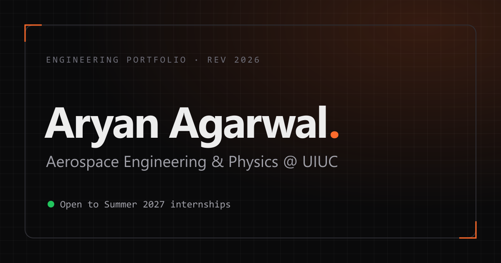

# Aryan Agarwal — Engineering Portfolio

**Live site → [aryan-agarwal1108.github.io](https://aryan-agarwal1108.github.io)**



My personal website and engineering portfolio. I study Aerospace Engineering & Physics at UIUC, and this site collects my projects, research, experience, and resume. The design is a dark "blueprint" theme: a faint engineering grid, datasheet-style spec boxes, and monospace drawing labels.

## Features

- **Project case studies:** each project gets its own page with a spec sheet, key metrics, and a problem, approach, and results write-up
- **Filterable project index** by discipline (Aerodynamics / Propulsion / Mechanical Design / Quantum / Optics)
- **Command menu:** press <kbd>Ctrl</kbd> / <kbd>⌘</kbd> + <kbd>K</kbd> to jump anywhere, copy my email, or switch the theme
- **Light and dark themes** that remember each visitor's choice
- **HTML and PDF resume:** the HTML version reads well on phones and can be parsed by applicant-tracking systems
- **Link-preview image** so the URL shows a proper preview card in LinkedIn, Handshake, Slack, and email
- **Fast and accessible:** static HTML, almost no JavaScript, keyboard navigable, and respects reduced-motion settings
- **Automatic deploys** to GitHub Pages through GitHub Actions on every push to `main`

## Tech stack

| | |
|---|---|
| Framework | [Astro](https://astro.build) (static output) |
| Styling | [Tailwind CSS v4](https://tailwindcss.com) + CSS custom properties |
| Content | Markdown content collections, with frontmatter validated by Zod |
| Fonts | Geist Sans + Geist Mono |
| Hosting | GitHub Pages + GitHub Actions |

## Project structure

```
├── .github/workflows/deploy.yml   # build + deploy to GitHub Pages
├── public/
│   ├── files/Aryan_Agarwal_Resume.pdf  # ← resume
│   ├── images/                    # ← project photos and headshot
│   ├── favicon.svg
│   └── og.png                     # link-preview image (generated)
├── scripts/make-og.mjs            # regenerates og.png from config
└── src/
    ├── config.ts                  # ← name, links, experience, skills
    ├── content/projects/*.md      # ← one file per project
    ├── components/                # header, cards, command menu, …
    ├── layouts/BaseLayout.astro   # <head>, SEO, theme, page shell
    ├── pages/                     # home, projects, experience, awards, about, resume, 404
    └── styles/global.css          # design tokens + theme
```

## Editing the content

1. **Personal info, experience, skills, about-page content:** edit `src/config.ts`. Each role can link to several projects through its `projects:` list.
2. **Projects:** copy `src/content/projects/_template.md` to a new file in the same folder, since the frontmatter fields (role, timeline, metrics, links) fill in the spec sheet automatically. Set `featured: true` to show the project on the home page.
3. **Project images:** put them in `public/images/` and set `cover: /images/your-file.jpg` in the project's frontmatter.
4. **Resume:** replace `public/files/Aryan_Agarwal_Resume.pdf`.
5. **Link-preview image:** after changing your name or title, run `node scripts/make-og.mjs`.

## Running locally

Requires Node.js 22.23 or newer.

```bash
npm install
npm run dev       # http://localhost:4321
npm run build     # production build in ./dist
npm run preview   # preview the production build
```

## Deploying

The repo is named `<username>.github.io`, so the site is served from the root URL. In **Settings → Pages**, set **Source** to **GitHub Actions**. After that, every push to `main` rebuilds and redeploys the site.

## License

The code is licensed under [MIT](LICENSE). The written content and images are © Aryan Agarwal.
